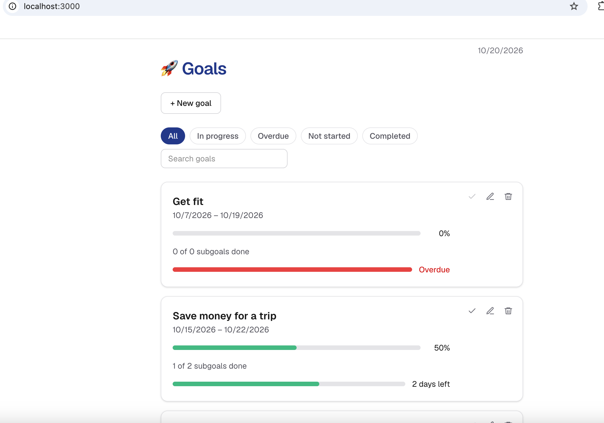

# 🚀 Goals

A small app for tracking personal goals. Each goal has a start and end date and
a checklist of subgoals; its progress is the share of subgoals completed.



## Features

- Add a goal with a title, start date and end date, then edit or delete it.
- Open a goal to add, edit, delete and tick off its subgoals. Each subgoal has
  its own title and dates.
- Progress bar and "X of Y subgoals done" on every goal and goal page.
- Time bar showing how much of the date span has passed: "N days left",
  "Due today", "Not started", red "Overdue", or "Completed!".
- Complete a whole goal in one click from its card (marks every subgoal done).
- Filter by status (All, In progress, Overdue, Not started, Completed) and
  search by title. Both reset on reload.
- Lists are sorted by end date, with overdue items first.
- Deleting a goal also deletes its subgoals.
- Light and dark mode.

## Getting started

```bash
npm install
npm run dev
```

Then open [http://localhost:3000](http://localhost:3000).

Other scripts:

- `npm run lint` checks the code.
- `npm run build` makes a production build.

## Data and privacy

The app runs locally only. There is no backend, API or user account. Your goals
are saved in your browser's `localStorage` (key `goals-app`), so they stay in
that browser and on that origin: opening the app on a different port shows an
empty list.

## Tech stack

Next.js (App Router), React, TypeScript and Tailwind CSS.

## Project structure

- `app/page.tsx`: home page with the add-goal form and goals list.
- `app/goals/[id]/page.tsx`: goal page with its subgoals.
- `app/components/`: UI components.
- `app/lib/goals.ts`: types, validation, progress, status, sorting and search.
- `app/lib/goals-store.ts`: all reading and writing of localStorage.

## Documentation

- [docs/decisions.md](docs/decisions.md): why localStorage.
- [docs/storage-research.md](docs/storage-research.md): browser storage research.
- [docs/api-schema.md](docs/api-schema.md): stored data and store functions.
- [AGENTS.md](AGENTS.md): project guidelines for AI coding agents.
